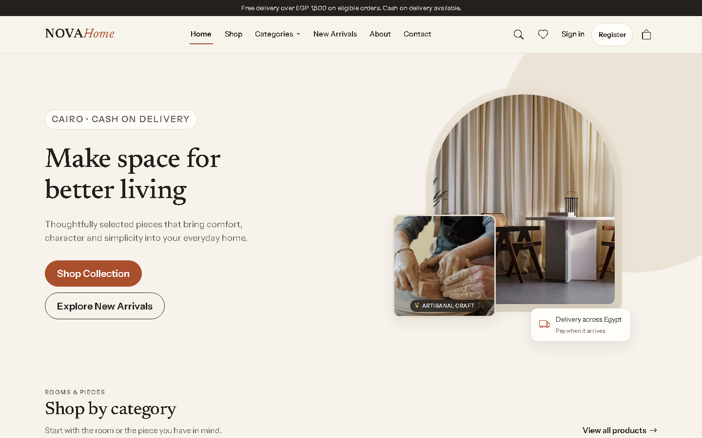
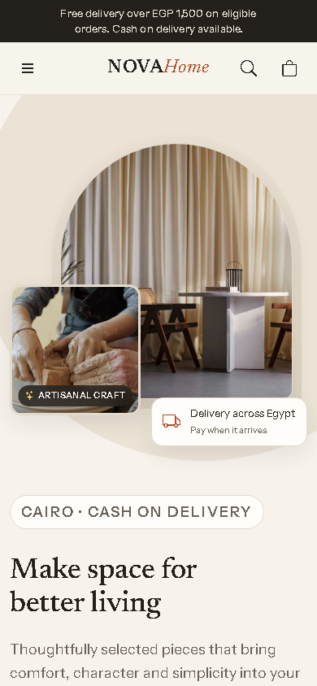
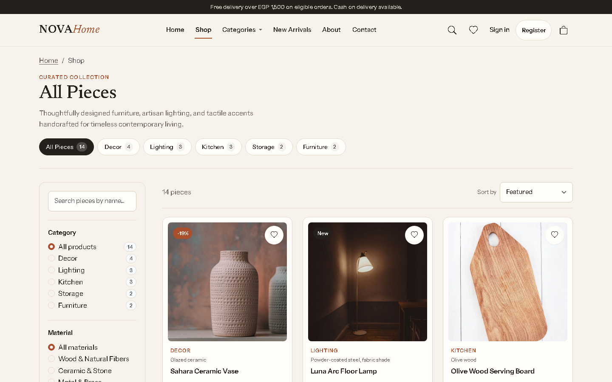
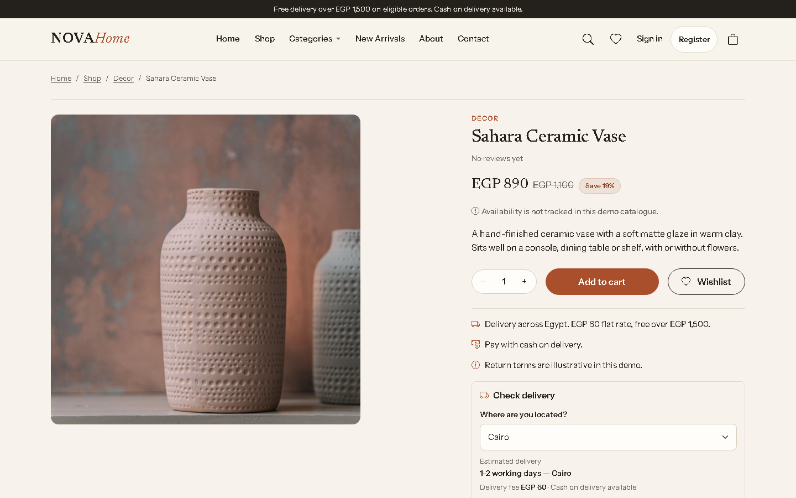
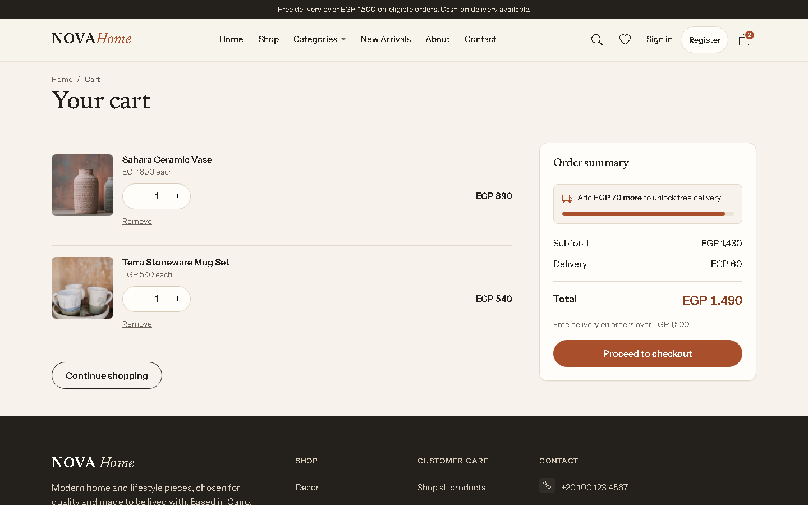
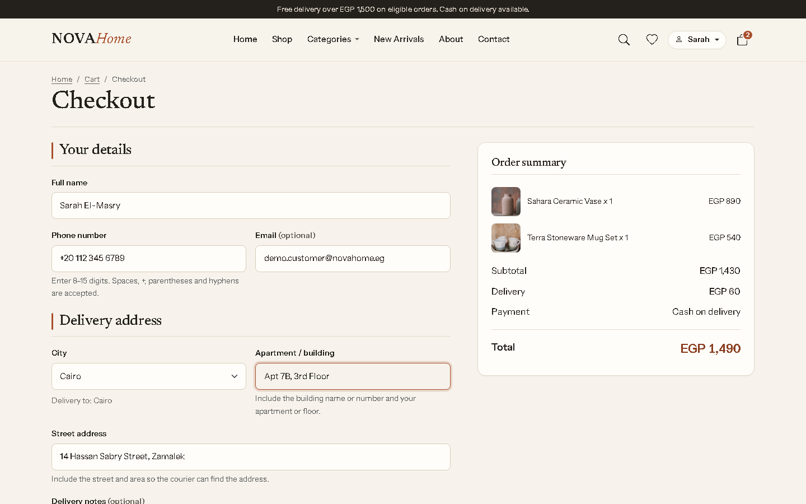
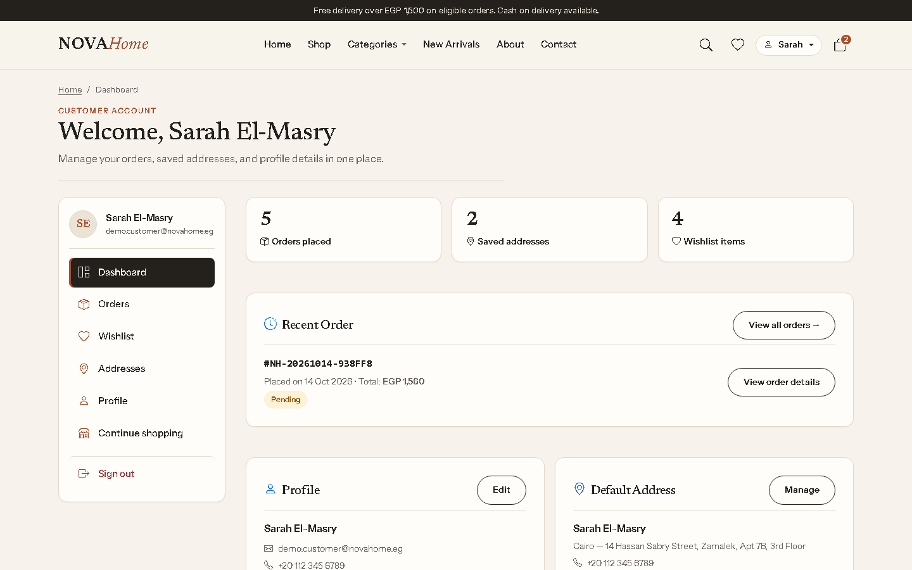
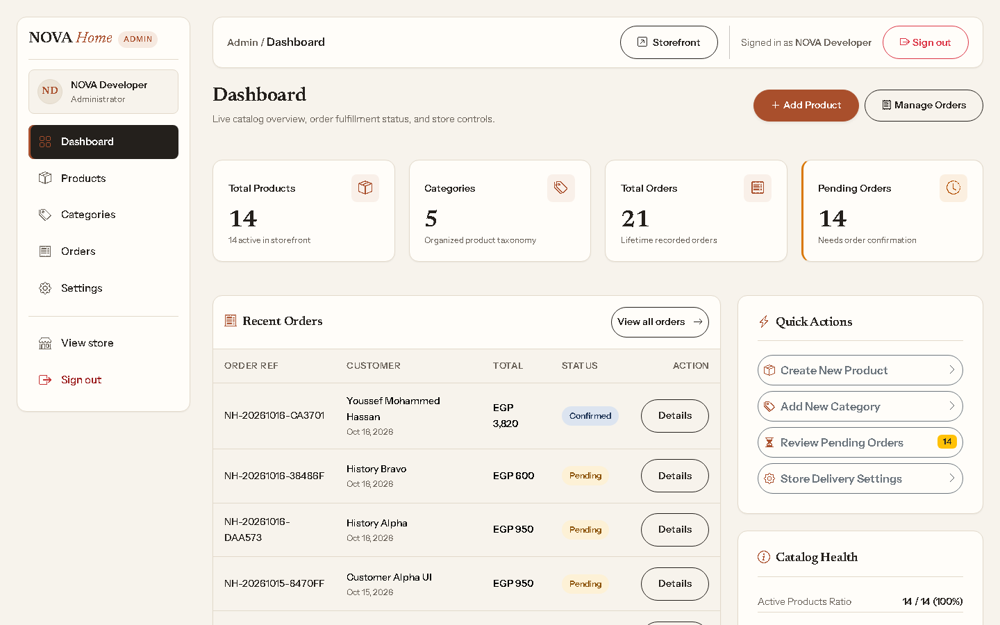

# NOVA Home

A full-stack home and decor e-commerce demo built for the Egyptian market. NOVA Home brings together a responsive storefront, product discovery, customer accounts, Cash on Delivery checkout, and an administrator portal.

**Live demo:** [nova-home.fast-page.org](https://nova-home.fast-page.org/) · [Customer demo](https://nova-home.fast-page.org/account/login.php) · [Admin demo](https://nova-home.fast-page.org/admin/login.php) · [Source code](https://github.com/youssefmohammed12/Nova)

> **Portfolio project, not a commercial store.** Checkout supports Cash on Delivery only; no online payment gateway is connected. The hosted demo uses synthetic customer and administrator accounts with shared, changeable sample data. Do not enter real personal, address, or payment information.

## What you can do

### Shop and discover products
- Browse a responsive homepage, product catalogue, categories, and product details.
- Search with keyboard-accessible suggestions; filter by category, material, and price; sort results.
- Preview products with Quick View and inspect product images, specifications, and delivery information.
- Add products to a browser-based cart or wishlist.

### Customer account
- Register, sign in, and manage a profile.
- View a dashboard, order history, and order details.
- Save and manage delivery addresses.
- Access the wishlist from the account area.

### Checkout and orders
- Complete a Cash on Delivery checkout while signed in.
- Review an order confirmation and view persisted orders from the account.
- Have the server validate products and quantities and recalculate prices and delivery fees before saving an order.

### Store administration
- View store activity and dashboard metrics.
- Create and edit products, manage product visibility, and maintain categories.
- Review orders and update their supported fulfilment statuses.
- Manage store identity and delivery settings.

## Try the live demo

Open either login page above and use its **Explore Customer Demo** or **Explore Admin Demo** option.

- The customer account contains synthetic sample details, saved addresses, orders, and wishlist items.
- The administrator demo has normal management permissions over the demo store, including catalogue, order-status, and settings changes.
- Demo data is shared and mutable. Changes made by other visitors may be visible, and the dataset may be reset.
- Use the demo data only. Never enter real customer information or sensitive details.

## Technology

| Area | Technologies |
| --- | --- |
| Server | PHP 8.1+, PDO, PHP sessions |
| Database | MariaDB 10.4+ or MySQL 8+, InnoDB, **utf8mb4** |
| Frontend | Semantic HTML, custom CSS, vanilla JavaScript |
| UI libraries | Bootstrap 5.3.8, Bootstrap Icons 1.13.1, Swiper 14.3.0 |
| QA tooling | Node.js 18+ and Playwright (optional) |

There is **no frontend build step** and no framework or ORM. The site runs on a PHP/MySQL web server; Node.js is only needed for the optional automated tests and developer scripts. The UI libraries and fonts are loaded from pinned external CDN resources.

## Screenshots

The gallery contains eight recent captures of the main storefront and shopping workflows. Open the section to view them.

<details>
<summary>View the NOVA Home screenshot gallery</summary>

### Storefront









### Shopping and customer account







### Admin portal



</details>

## Run it locally

These instructions use Windows and XAMPP. The same application can run on another Apache/PHP/MySQL setup with equivalent paths and configuration.

### Requirements

- PHP 8.1+ with the PDO MySQL extension.
- Apache with .htaccess support enabled (AllowOverride All).
- MariaDB 10.4+ or MySQL 8+.
- A modern browser and internet access for the external UI assets.
- Optional: Node.js 18+ for the automated QA scripts.

### 1. Get the project

Start Apache and MySQL from the XAMPP Control Panel. Open Command Prompt and clone the repository into the XAMPP web root:

```bat
cd C:\xampp\htdocs
git clone https://github.com/youssefmohammed12/Nova.git nova-home
cd nova-home
```

The project root is the folder containing README.md.

### 2. Create and seed the database

Run these commands from the project root in Command Prompt. The schema creates the nova_home database and its tables; the seed file inserts the sample catalogue and store settings.

```bat
C:\xampp\mysql\bin\mysql.exe -u root < database\schema.sql
C:\xampp\mysql\bin\mysql.exe -u root nova_home < database\seed.sql
```

If your MySQL root account has a password, add -p after -u root and enter it when prompted.

### 3. Create your local configuration

Copy the tracked example file:

```bat
copy config\config.example.php config\config.php
```

Edit config/config.php and check the database connection values. The example uses the default local XAMPP database account (root with an empty password); change these values when your local setup differs.

The example starts in development mode with local error display enabled, keeps **demo_access** disabled, sets **public_demo_access** to false, and lets **base_url** be detected automatically. Keep the real config/config.php private: it is ignored by Git and must never be committed.

### 4. Create an administrator

A fresh database has no administrator account. Create one from the project root:

```bat
C:\xampp\php\php.exe scripts\create_admin.php "Your Name" "admin@example.com"
```

The script asks for the password interactively. The password is not passed as a command-line argument, and the script stores a password hash rather than the plaintext password.

### 5. Open the website

Visit:

```text
http://localhost/nova-home/
```

The application detects its base path automatically, so a differently named or nested local folder can also work. The development health endpoint is available at /health.php; it is intentionally unavailable in production.

## Optional QA checks

Node.js 18+ is required only for the automated checks. From the project root:

```bat
npm ci
npm.cmd run test:syntax
```

With Apache running and the local site seeded, you can also run the focused browser and read-only release checks:

```bat
set NOVA_BASE_URL=http://localhost/nova-home/
npm.cmd run test:shop-ui
npm.cmd run test:release-readiness
```

Change NOVA_BASE_URL to match your local project URL. The shop UI suite uses browser-local test state; the release-readiness suite performs GET-only checks. Run automated tests against a local development copy, never against real customer or production data.

## How the application is structured

The storefront pages use vanilla JavaScript controllers and shared UI modules to load catalogue and store-setting data from the PHP JSON API. The cart and wishlist are stored in the browser. Customer and administrator pages are server-rendered PHP pages protected by server-side session checks.

At checkout, the browser sends product identifiers and quantities. The server validates the request, retrieves current product prices and delivery settings, recalculates the total, and stores the order in a database transaction.

```text
nova-home/
├── index.html, shop.html, product.html
├── cart.html, checkout.html, order-success.html
├── account/             Customer pages and account workflows
├── admin/               Administrator portal
├── api/                 PHP JSON endpoints
├── assets/images/       Product and category imagery
├── config/              Local configuration template and PDO setup
├── css/                 Design tokens, base, components, pages, responsive styles
├── database/            Schema, seed data, and historical migrations
├── docs/                Project documentation and screenshots
├── includes/            Shared PHP bootstrap, auth, validation, and layout
├── js/                  Storefront controllers and shared UI modules
└── scripts/              CLI utilities and automated tests
```

## Security and deployment

The project includes prepared PDO statements, server-side input validation, password hashing, CSRF protection for state-changing requests, hardened sessions, separate customer/admin authorization checks, order-ownership enforcement, and server-side order repricing. Sensitive directories are protected by .htaccess; the web server must honor those rules or provide equivalent access restrictions.

For any public deployment:

- Use HTTPS and a dedicated database account with only the permissions the application needs.
- Set **env** to production and **debug** to false.
- Keep config/config.php, database backups, and real customer data out of Git and the public web root.
- Keep **demo_access** disabled in production. Set **public_demo_access** to true only on the intentional portfolio demo; leave it false on other deployments.

This application needs a PHP runtime and a MySQL-compatible database. **GitHub Pages cannot host the PHP backend.** The public portfolio demonstration currently runs at [nova-home.fast-page.org](https://nova-home.fast-page.org/).

## Scope and current limitations

- Cash on Delivery is the only checkout method; there is no card or mobile-wallet payment integration.
- Cart and wishlist contents are stored in the visitor's browser. Orders are stored in the database.
- Product stock is not tracked, and delivery estimates are informational rather than connected to a courier service.
- Email/SMS order notifications and a password-reset flow are not implemented.
- Product reviews are not currently collected or displayed as verified customer reviews.

## Developer notes and credits

- [PROJECT_GUIDE.md](PROJECT_GUIDE.md) — deeper architecture, data model, business rules, security conventions, and development guidance.
- [docs/IMAGE_SOURCES.md](docs/IMAGE_SOURCES.md) — product photography sources and licensing information.
- [docs/development/INFINITYFREE_DEMO_SETUP.md](docs/development/INFINITYFREE_DEMO_SETUP.md) — maintainer runbook for the hosted demo environment.

Product photographs are sourced from Pexels and used under the [Pexels License](https://www.pexels.com/license/). See the image-sources document for the individual source records.
